# TOPCAT, ADQL, Datalink and GaiaXPy tutorial

*Gaia DR4 hands-on workshop · using Gaia DR3 data*

*Hands-on session of the Gaia DR4 workshop. Gaia raw/epoch data products and the non-single-star tables are covered in a separate session and are not part of this tutorial.*

[TOPCAT](https://www.star.bris.ac.uk/~mbt/topcat/) is a cross-platform, open-source **T**ool for **OP**erations on **C**atalogues **A**nd **T**ables that "does what you want with tables", as its slogan says. It is a great tool for data exploration, and it speaks the Virtual Observatory (VO) protocols, so it can talk directly to the Gaia archive and to any other TAP service.

> [!TIP]
> Gaia DR4 is scheduled for **2 December 2026**. Everything below uses the Gaia **DR3** tables (`gaiadr3.*`), which are the live data at the time of the workshop. The same queries should work on DR4 by replacing `gaiadr3` with `gaiadr4` (check the [DR4 data model](https://www.cosmos.esa.int/web/gaia/dr4) for renamed columns and the new tables). The `gaia_source` structure, the quality flags and the Datalink products described here all carry over to DR4, which adds epoch data for all sources.

## 0. Before we start

- **The tutorial material** (this text, the notebook, `environment.yml`, the small data files) is in a GitHub repository: https://github.com/naamach/gaia-dr4-workshop. Get a local copy either with git, in a terminal:
  ```bash
  git clone https://github.com/naamach/gaia-dr4-workshop.git
  cd gaia-dr4-workshop
  ```
  or without git: on the repository page press the green **Code** button, choose **Download ZIP**, and unpack it. Then download the 100 pc sample `GaiaDR3_100pc.fits` (190 MB) from the repository's **Releases** page (https://github.com/naamach/gaia-dr4-workshop/releases/latest/download/GaiaDR3_100pc.fits) and put it in the `data/` folder. If you cloned with git, `git pull` later fetches any updates to the material.
- **TOPCAT ≥ 4.10** (4.10-8 at the time of writing). Download the `topcat-full.jar` or an installer from the [TOPCAT site](https://www.star.bris.ac.uk/~mbt/topcat/). You need Java 8 or later.
- **A Gaia archive account** (free): [register here](https://www.cosmos.esa.int/web/gaia-users/register). Since the archive upgrade of October 2026, anonymous users have tight limits: an anonymous asynchronous job is aborted after about a minute, a synchronous query that runs longer than ~30 s returns at most 2000 rows, and at most 5 jobs run in parallel. Registered users get the larger quotas, saved jobs and 1 GB of space for uploaded tables. In TOPCAT you log in from the TAP window (**Authenticate** button).
- **Python** (for sections 9–10 and some exercises): the conda environment file `environment.yml` that comes with this tutorial (astropy, astroquery, GaiaXPy ≥ 2.1.5, matplotlib, pandas, JupyterLab). The companion notebook is `gaia_dr4_workshop.ipynb`. To set it up:
  1. If you don't have conda yet, install [Miniforge](https://conda-forge.org/download/) (a minimal conda that uses the conda-forge channel; Anaconda or Miniconda work too).
  2. In a terminal, from the folder that contains `environment.yml`:
     ```bash
     conda env create -f environment.yml
     conda activate gaia-workshop
     jupyter lab gaia_dr4_workshop.ipynb
     ```
     The first command downloads and installs the packages (a few minutes); the second switches to the new environment (do this in every new terminal); the third opens the notebook in your browser.
  3. To update the environment after `environment.yml` changes: `conda env update -f environment.yml --prune`. To remove it: `conda env remove -n gaia-workshop`.
  
  If you prefer plain pip in an existing Python ≥ 3.11 installation: `pip install astropy astroquery "gaiaxpy>=2.1.5" matplotlib pandas jupyterlab`.
- Optional: [Aladin](https://aladin.cds.unistra.fr/) for section 7.

## 1. Running a TAP query

First, we need some tabular data to work with. Let's get the Gaia nominal 100 pc sample by running a **Table Access Protocol (TAP)** query.

In the main TOPCAT window, open the **VO** menu and choose **Table Access Protocol (TAP) Query**.

In the TAP window, search for a Gaia service by entering `gaia` in the **Keywords** field and pressing **Find Services**, then choose the **ESAVO** TAP service (the ESA Gaia archive) from the list:

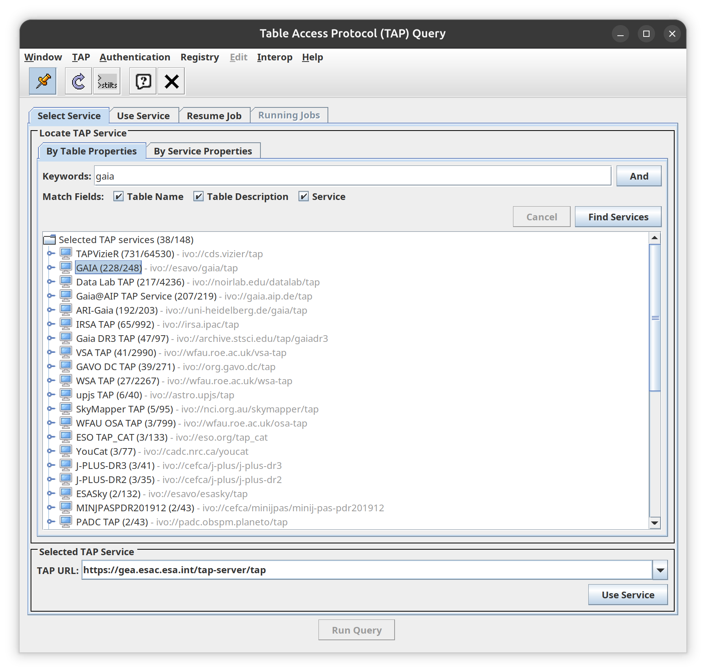

This fills the **TAP URL** field with `https://gea.esac.esa.int/tap-server/tap`. Press **Use Service**.

The **Use Service** tab lists the tables available from the selected service; find `gaiadr3.gaia_source` and look at its column metadata. (Note also `gaiadr3.gaia_source_lite`, a slimmed-down copy with the most-used columns that is much faster to query.) In the ADQL text field enter:

```sql
SELECT TOP 100 *
FROM gaiadr3.gaia_source
WHERE parallax_over_error > 10
AND phot_bp_mean_flux_over_error > 10
AND phot_rp_mean_flux_over_error > 10
AND parallax > 10
```

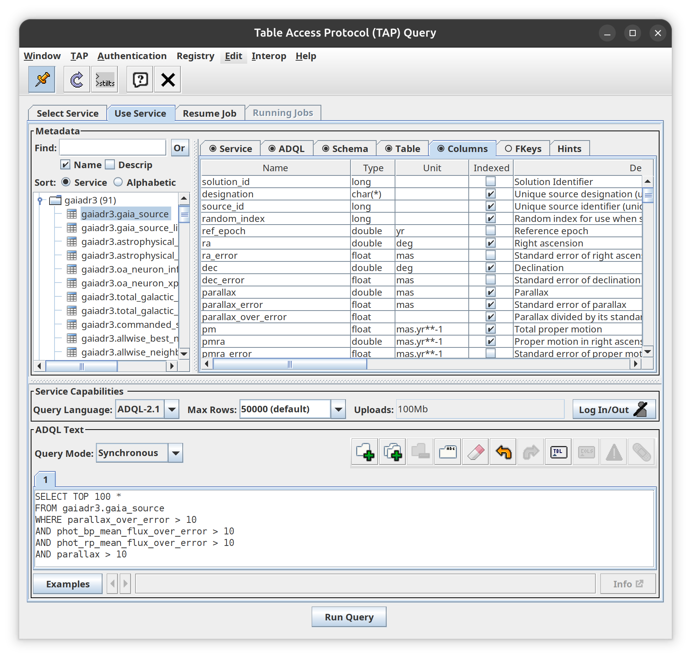

`TOP 100` limits the result to the first 100 rows; remove it to get the full sample. Press **Run Query**. The **Mode** selector at the bottom switches between *Synchronous* (the result comes back in the same connection; fine for short queries) and *Asynchronous* (the job runs on the server, you can watch it in the **Running Jobs** tab and even resume it in a later session from **Resume Job**). Anything that takes more than a few seconds should run asynchronously, and you should be logged in.

Since the full query returns 306,517 rows × 152 columns and takes a few minutes, we can import the already downloaded Gaia DR3 100 pc sample instead: [`GaiaDR3_100pc.fits`](https://github.com/naamach/gaia-dr4-workshop/releases/latest/download/GaiaDR3_100pc.fits) (190 MB, attached to the tutorial's GitHub release). It was saved in FITS format, since FITS tables are imported much faster by TOPCAT than, e.g., CSV, so if you have a very large table it is better to save it as FITS. The file was produced with the query above (the script `make_sample.py` that comes with the tutorial reproduces it).

To import the file, return to the main TOPCAT window and open it with **File > Load Table**. Once imported, it appears in the main window's table list:

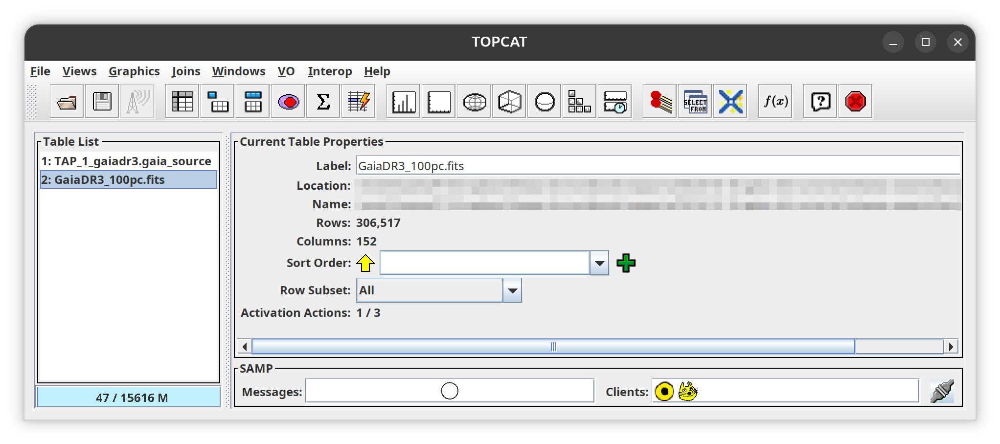

## 2. ADQL

The query is written in **ADQL** (Astronomical Data Query Language). It is very similar to SQL, if you are familiar with it, with a few astronomical additions (`POINT`, `CIRCLE`, `DISTANCE`, `CONTAINS`). Useful links:

- [Gaia archive: writing queries](https://www.cosmos.esa.int/web/gaia-users/archive/writing-queries) (example queries, time-outs, uploads)
- [SIMBAD ADQL cheat sheet](https://simbad.cds.unistra.fr/simbad/tap/help/adqlHelp.html)
- [ADQL standard](https://www.ivoa.net/documents/ADQL/) (full documentation)
- TOPCAT's own **Examples** menu in the TAP window, which fills in working queries for the selected service, and the **Hints** tab

### ADQL tips

- Performing calculations in the query takes time. It is better to use pre-tabulated columns (e.g. `bp_rp` instead of `phot_bp_mean_mag - phot_rp_mean_mag`), and the `gaia_source_lite` table when you don't need the full column set.
- There is a query time-out, so if your query is too long it will fail. Workarounds:
  - Use **asynchronous** mode instead of synchronous.
  - **Log in.** Registered users have longer time-outs, no row cap, saved queries, and space for user tables (see section 0).
  - Query by parts using the `random_index` column, e.g. add `AND random_index BETWEEN 0 AND 499999999` to the query, then `BETWEEN 500000000 AND 999999999`, etc. `random_index` is also the way to get a random subsample: `ORDER BY random_index` with `TOP n`.
  - The same `gaiadr3` tables are served by other TAP services, e.g. **ARI-Gaia** (`https://gaia.ari.uni-heidelberg.de/tap`, Heidelberg) and **GAVO** (`http://dc.g-vo.org/tap`, `gaia.dr3lite`). The same ADQL works there, which is useful when the ESA archive is busy, and TOPCAT finds them with the same `gaia` keyword search.
- You can upload a local table to the TAP service (or the Gaia archive) for cross-matching (section 6). In TOPCAT a loaded table is referred to in ADQL as `TAP_UPLOAD.t<n>`, where `<n>` is its ID in the main window. All its column names must be valid ADQL identifiers (no spaces, dots or other punctuation); rename offending columns first.
- Cone searches in ADQL: `WHERE 1 = CONTAINS(POINT('ICRS', ra, dec), CIRCLE('ICRS', ra0, dec0, radius_deg))`, and `DISTANCE(POINT('ICRS', ra, dec), POINT('ICRS', ra0, dec0))` gives the separation in degrees. The ESA archive also accepts the newer form without the `'ICRS'` argument, but older ADQL 2.0 services (e.g. ARI-Gaia) require it. Inequality is `<>` (not `!=`), and `ORDER BY` takes plain column names.

## 3. Plotting the HR diagram

To plot the Gaia colour–magnitude diagram we need the absolute magnitude of each source. Choose **Views > Column Info** (or press the Column Info button) in the main window. A window listing the table's columns opens:

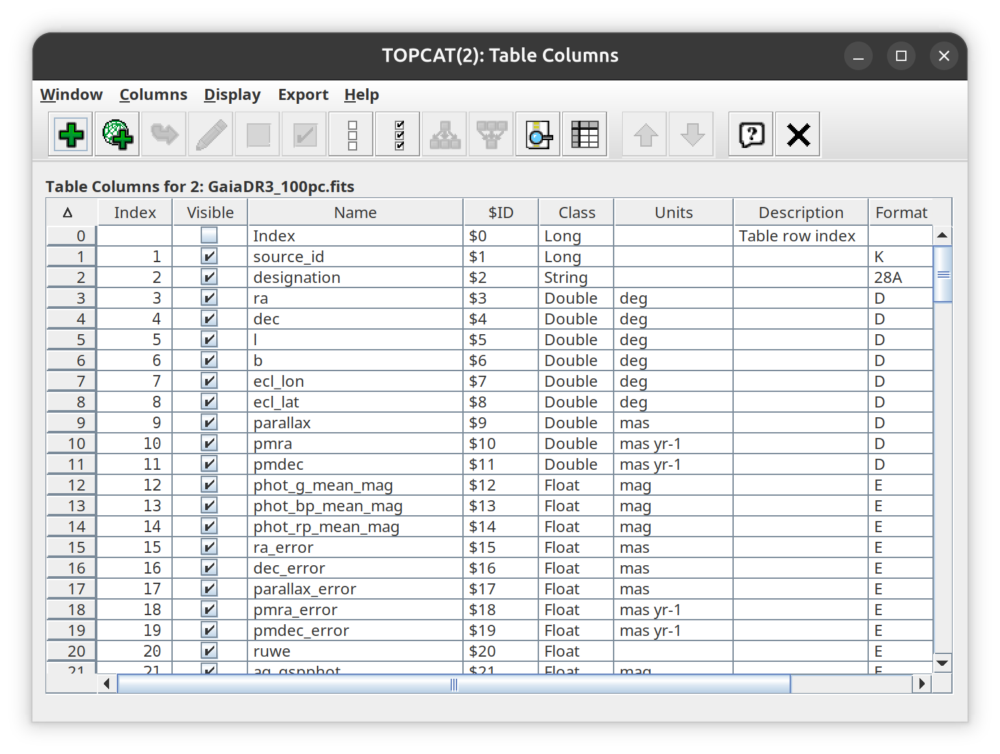

Add an absolute magnitude column named `mg` by pressing the **+** button and entering the expression

```
phot_g_mean_mag + 5*log10(parallax) - 10
```

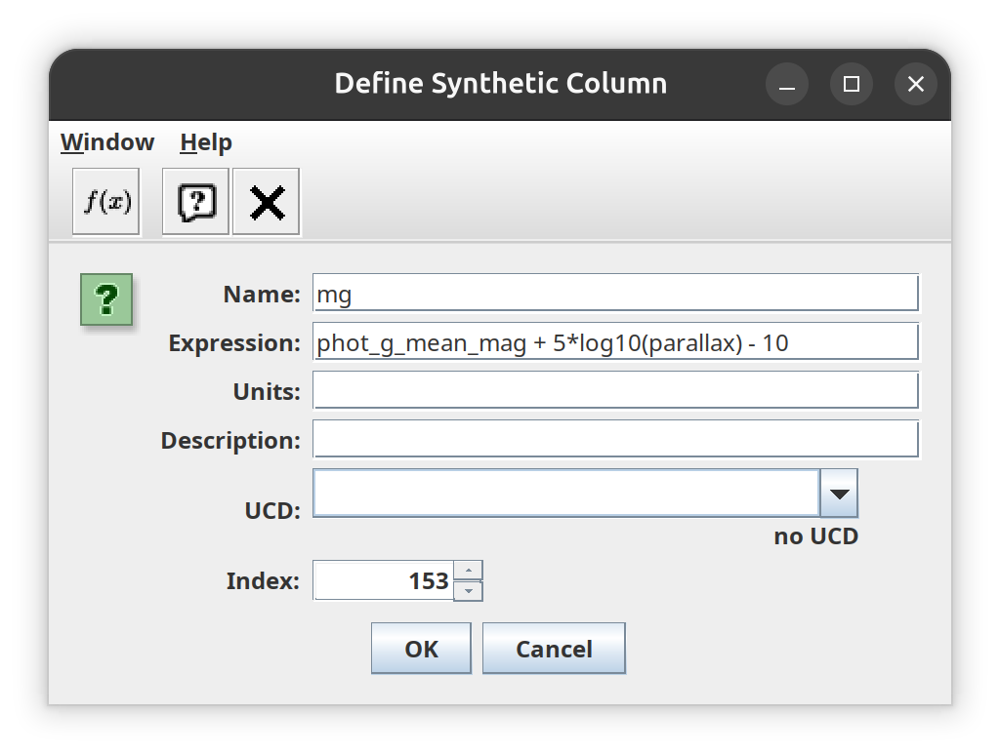

Note that this expression is valid only for sources with `parallax_over_error` ≳ 5; otherwise there are things you need to take into account (see [Bailer-Jones et al. 2021](https://ui.adsabs.harvard.edu/abs/2021AJ....161..147B), whose distances are also in the archive as `external.gaiaedr3_distance`). It is also not corrected for extinction.

Now go back to the main window and choose **Graphics > Plane Plot**. Enter `bp_rp` as the X variable and `mg` as the Y variable. In the **Axes** control, **Coords** tab, tick **Y Flip**. Here is the HRD!

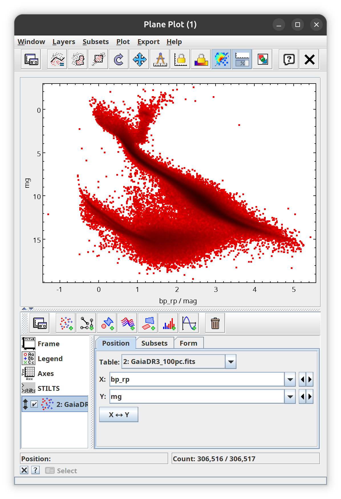

Try playing with the colouring options (the **Form** tab: e.g. **Shading: density** or **aux** with a third column).

The HRD looks very noisy. Let's clean it a bit.

## 4. Cleaning the sample using subsets

### Exclude astrometrically suspicious sources using an expression

`astrometric_excess_noise` measures the disagreement, expressed as an angle, between the observations of a source and the best-fitting standard astrometric model (five parameters). `astrometric_excess_noise_sig` measures its significance: if it is smaller than 2, the excess is probably not significant even if it is large.

Check which sources have a large `astrometric_excess_noise` by using it as the **aux** colour of the HRD.

Now add an `astrom_ok` subset using the expression

```
astrometric_excess_noise < 1 || astrometric_excess_noise_sig < 2
```

by choosing **Views > Row Subsets** in the main window and pressing the **+** button in the Row Subsets window:

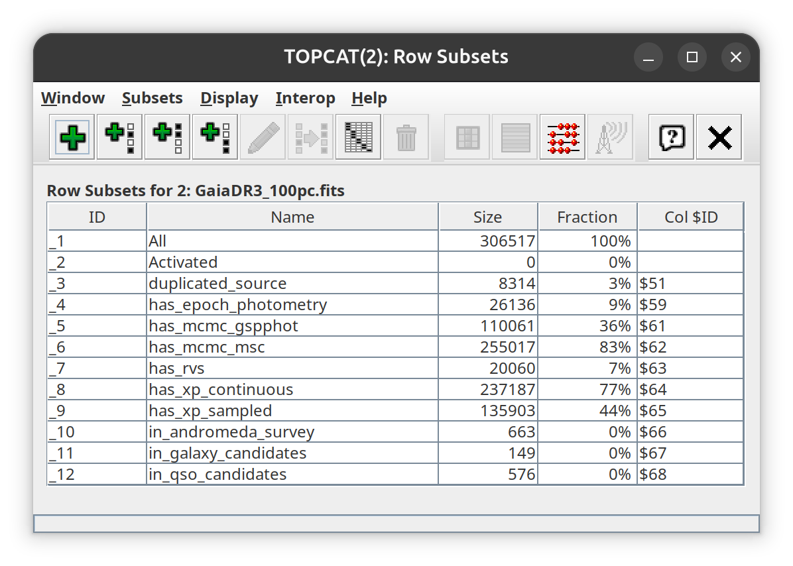
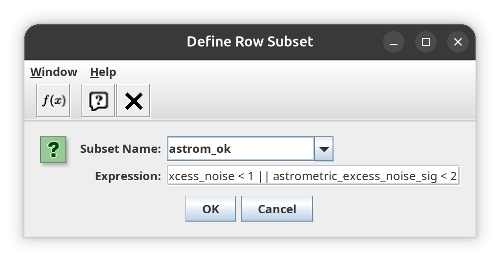

### Exclude photometrically suspicious sources using the selection tool

`phot_bp_rp_excess_factor` measures the excess of flux in the BP and RP integrated photometry with respect to the G band. Such an excess indicates an inconsistency between the fluxes, and a possible problem with the photometry of the source (blending, a nearby neighbour, a nebular background…).

We want to get rid of sources with a problematic excess factor. It is colour dependent, so start by plotting `phot_bp_rp_excess_factor` vs `bp_rp` with **Plane Plot**. Plot only the `astrom_ok` subset by choosing it in the **Subsets** tab of the plot window. Zoom into the interesting region with the mouse.

Create a subset of sources with a small excess factor using **Subsets > Draw Algebraic Subset > Below**. Click on the plot to draw a piecewise line defining the upper border of the subset. When finished, click the subset button with the ✓ symbol (second from the left) and name the new subset `phot_ok`:

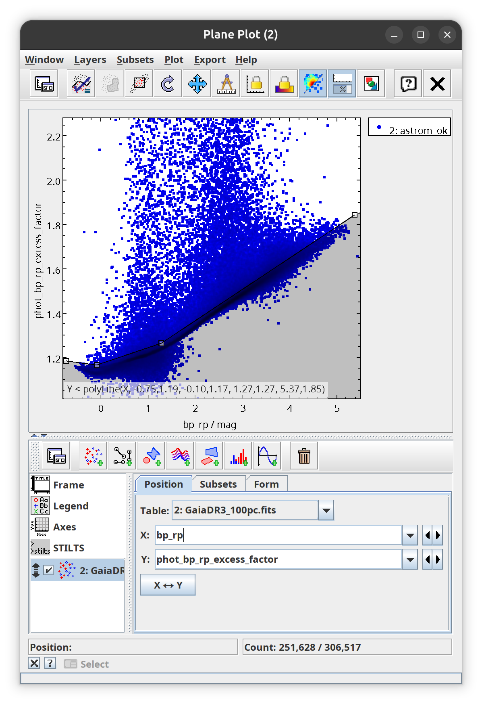
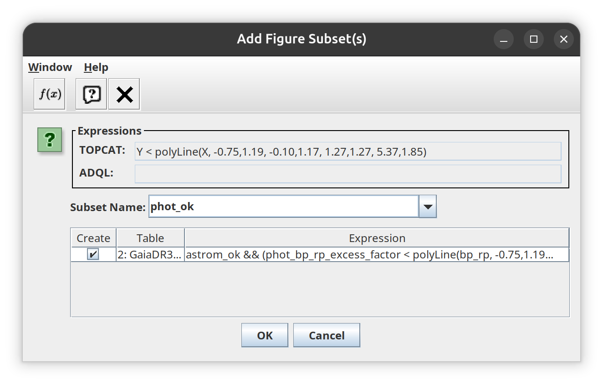

(An analytic alternative, used in the companion notebook: `phot_bp_rp_excess_factor < 1.3 + 0.06*pow(bp_rp, 2)`. [Riello et al. 2021](https://ui.adsabs.harvard.edu/abs/2021A&A...649A...3R) define a colour-corrected version, $C^*$, which is what you should use for serious work.)

### Exclude sources with a bad astrometric solution

RUWE (renormalised unit weight error) is the goodness-of-fit of the astrometric solution: basically the reduced χ² renormalised to remove its magnitude and colour dependence. A well-behaved single star has RUWE ≈ 1; values above ~1.4 indicate a problematic solution, very often an unresolved binary. Add a `ruwe_ok` subset from the Row Subsets window: `ruwe < 1.4`.

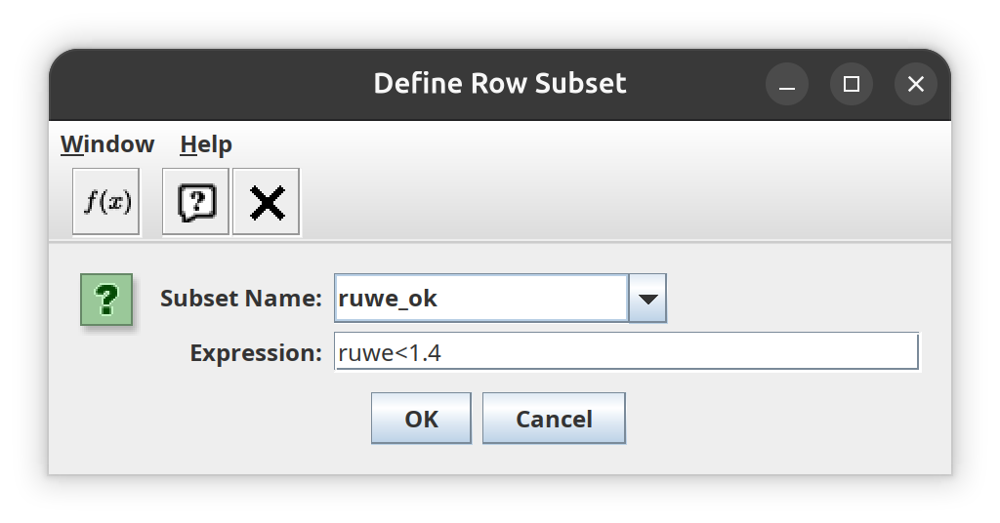

### Combining all subsets

Combine the three subsets by adding a new subset named `ok` in the Row Subsets window: `astrom_ok && phot_ok && ruwe_ok`.

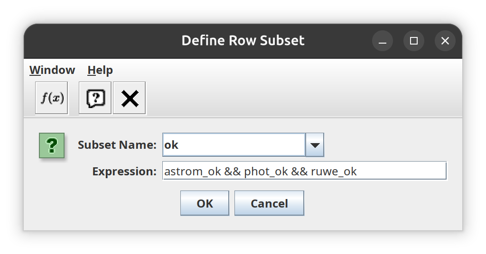

Our clean sample contains about 70% of the original sample (68% with the border drawn in the screenshots, 72% with the analytic `phot_ok` cut above; the exact number depends on where you draw it):

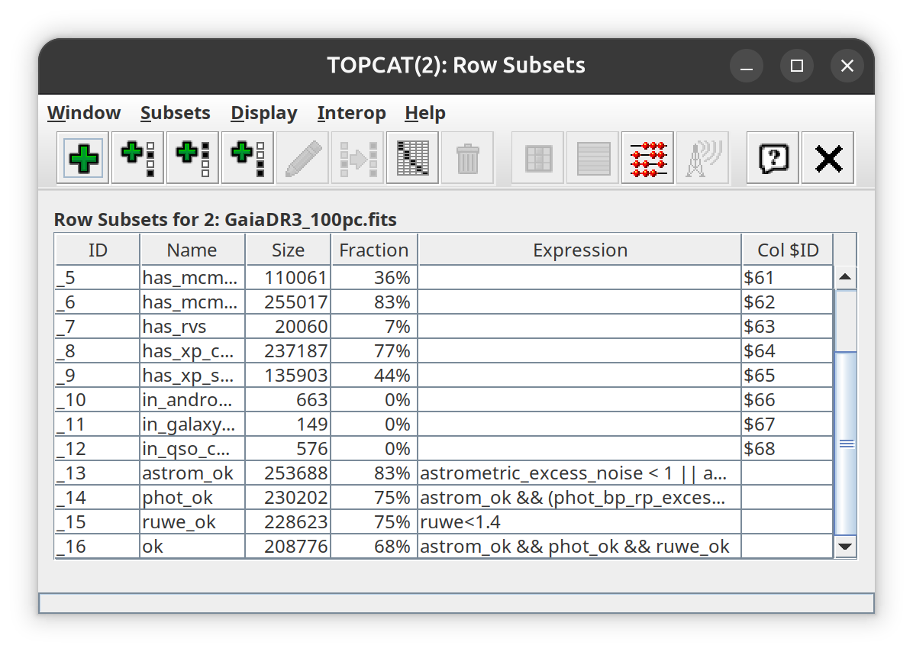

Go back to the HRD and check which parts were excluded (plot `ok` and its complement in different colours):

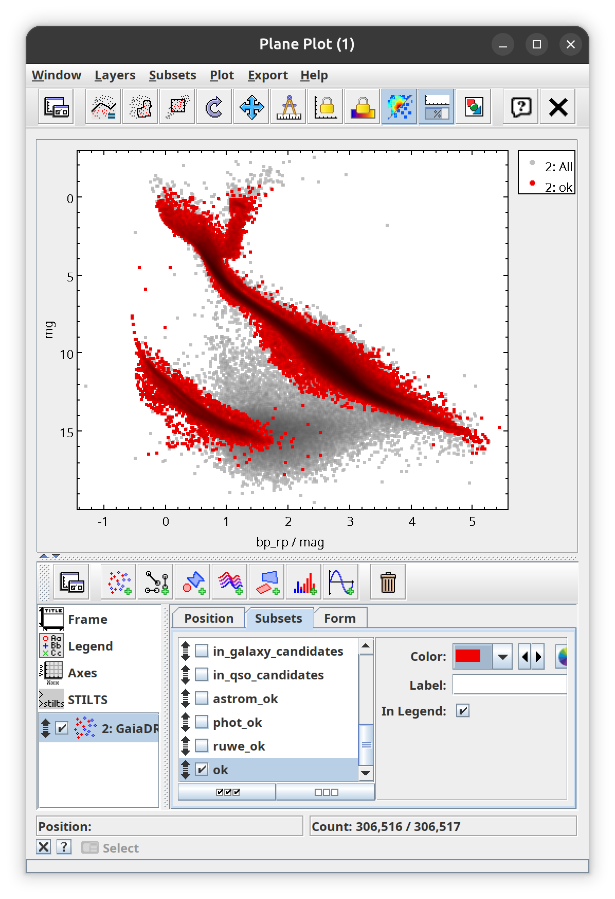

## 5. Exploring the white dwarf population

### Create a white dwarf subset using freehand selection

Select the white dwarf sequence in the HRD with **Subsets > Draw Blob Subset**, and create a `wd` subset (make sure only the `ok` subset is plotted first):

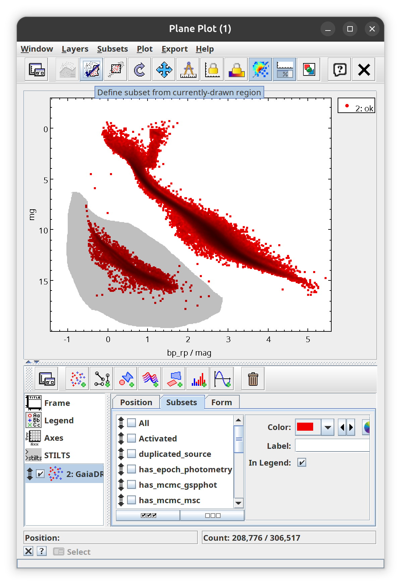
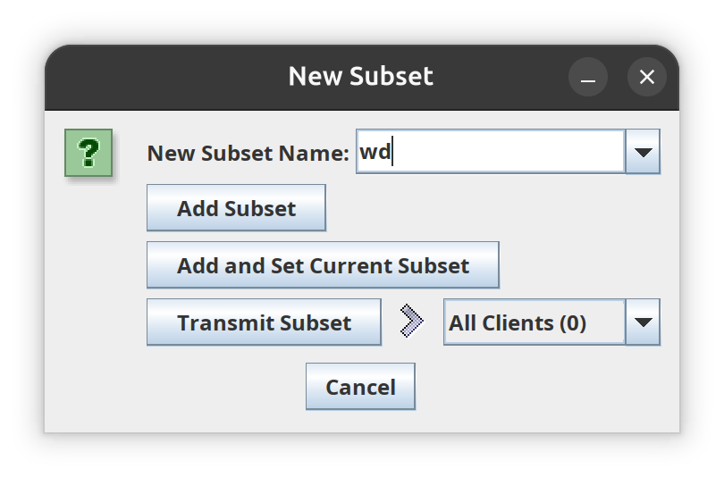

There are about 14,100 white dwarfs in the clean 100 pc sample. In code (companion notebook) the blob is replaced by the colour-magnitude cut of [Gentile Fusillo et al. 2021](https://ui.adsabs.harvard.edu/abs/2021MNRAS.508.3877G), `mg > 6 + 5*bp_rp`, which you can also type as a subset expression here.

### Cone search around the WD 20 pc sample

Create a subsample of white dwarfs within 20 pc: `wd && parallax > 50` (138 sources with the blob subset; 140 sources with the Gentile Fusillo et al. cut, 151 before the quality cuts; compare [Hollands et al. 2018](https://ui.adsabs.harvard.edu/abs/2018MNRAS.480.3942H), who found 139 systems in DR2):

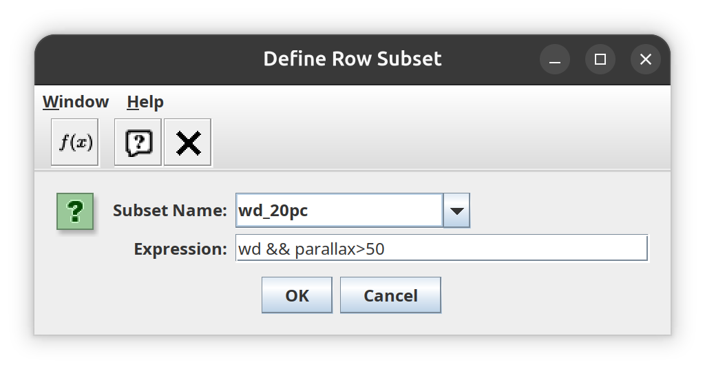

Now let's try to find possible wide companions within a projected separation of 100 AU from each WD in the sample. The search radius is

$$\theta = s\,\varpi ,$$

where $\theta$ is the angular separation in arcsec, $s$ the projected separation in AU, and $\varpi$ the parallax in arcsec. Define a new column `cone_radius` in arcsec: `1e-3*100*parallax` (parallax is in mas):

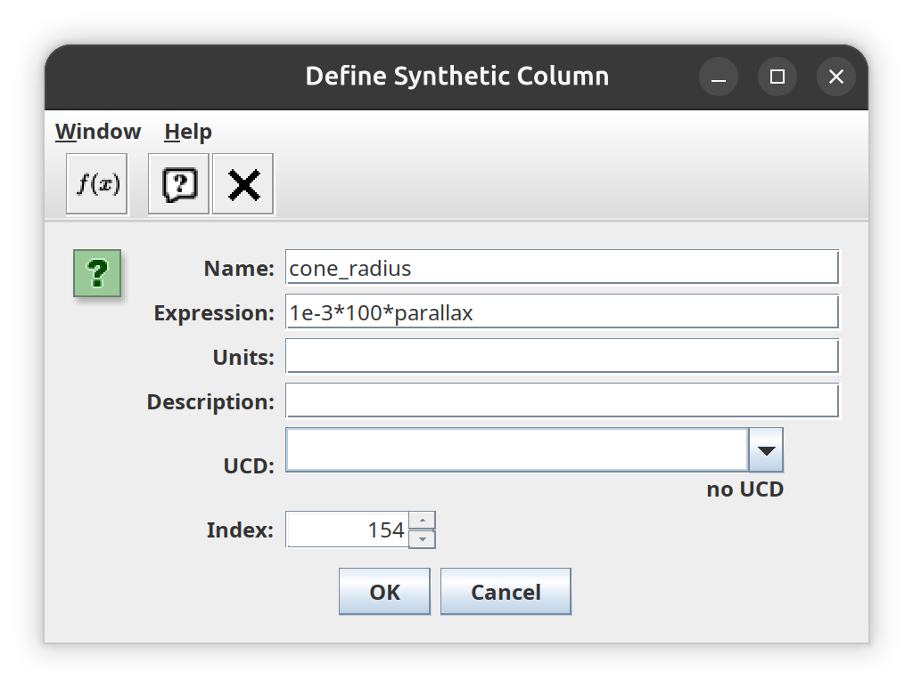

Now we can cone-search the Gaia database around the `wd_20pc` subsample. First make sure we only work with `wd_20pc` by selecting it in the **Row Subset** selector of the main window:

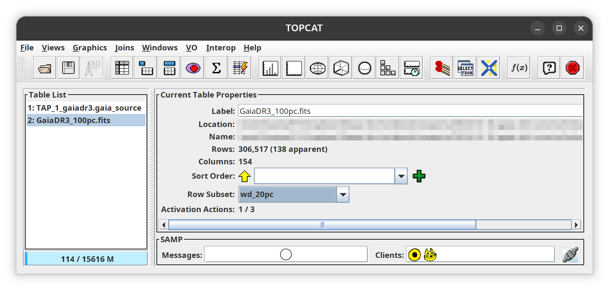

Then choose **VO > Multicone**. In the Multiple Cone Search window, search for the service **"Gaia DR3 at ESA"** (`ivo://esavo/gaia/csdr3`; ARI's cone search for DR3 also works). Choose `GaiaDR3_100pc.fits` as the **Input Table**, its `ra` and `dec` columns, and set the **Search Radius** to the `cone_radius` column. For the **Output Mode** choose **"New joined table with all matches"**, and press **Go**:

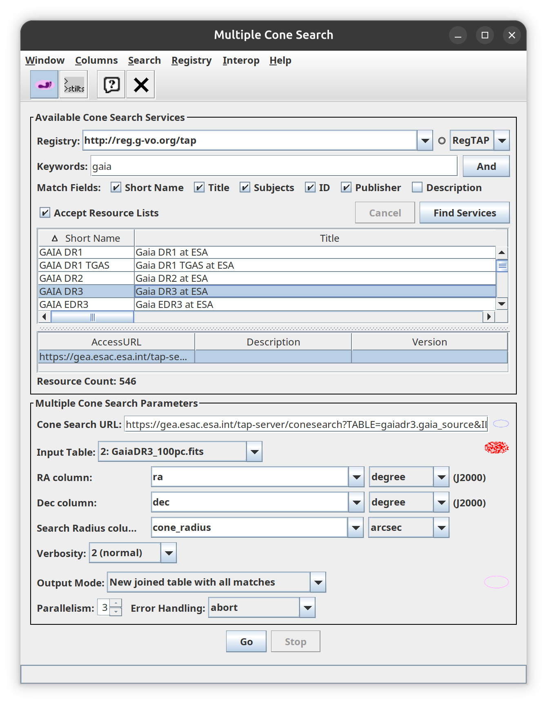

### Plotting the results

A new table called `cones(1)` appears. It contains the columns of the input table plus the Gaia data of the cone-search results with a `_cone` suffix, and a `Separation` column (the angular distance from the original WD, in degrees). The cone search also finds the original WDs themselves; filter them out by creating a `candidates` subset with `Separation > 1e-13`:


Make sure we use only `candidates` by choosing it in the main window.

Calculate the absolute magnitude of the resulting sources by adding an `mg_cone` column to the result table:

```
phot_g_mean_mag_cone + 5*log10(parallax_cone) - 10
```

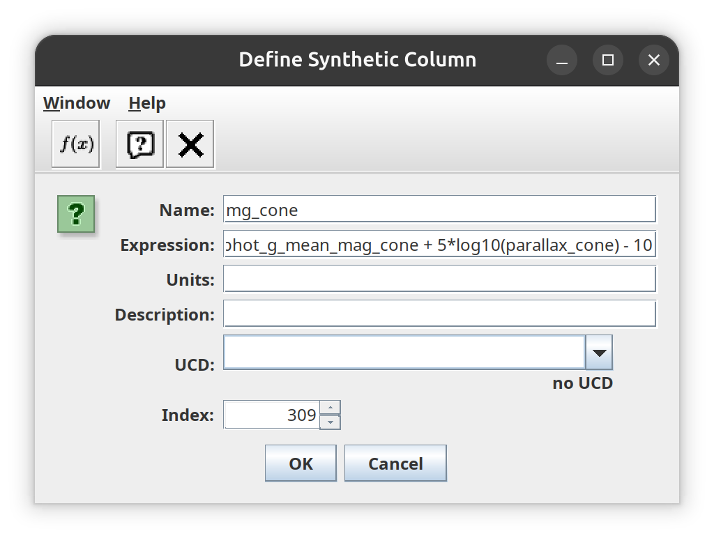

Now plot the found pairs on the HRD and connect them with lines. Use the clean HRD (the `ok` subset) from before as the background. In the Plane Plot window of the HRD add another layer with **Layers > Add Position Control**, choose the `cones(1)` table and plot `mg` vs `bp_rp`: these are the original 20 pc WDs. Add another Position Control, choose `cones(1)` again and plot `mg_cone` vs `bp_rp_cone`: the cone-search results. Finally connect the pairs with **Layers > Add Pair Control**: `bp_rp` as X(1), `mg` as Y(1), `bp_rp_cone` as X(2), `mg_cone` as Y(2):

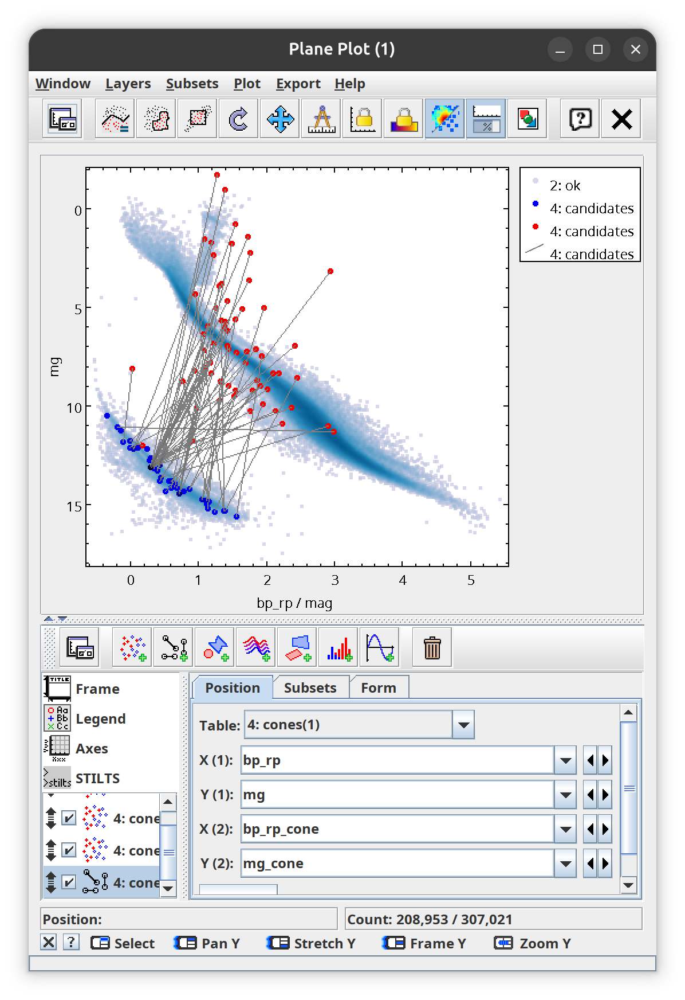

At first sight we found possible companions to some of the WDs! But remember that we searched the entire Gaia database around them without filtering anything; the candidates might have unreliable astrometry or photometry. Define an `ok_cone` subset:

```
parallax_over_error_cone > 10 && phot_bp_mean_flux_over_error_cone > 10 && phot_rp_mean_flux_over_error_cone > 10 && (astrometric_excess_noise_cone < 1 || astrometric_excess_noise_sig_cone < 2) && ruwe_cone < 1.4
```


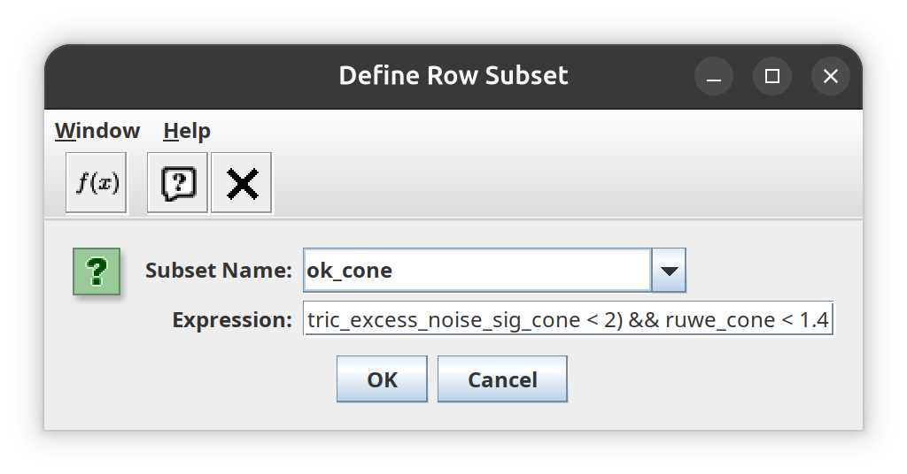

and combine it with `candidates` into `ok_candidates`: `candidates && ok_cone`:

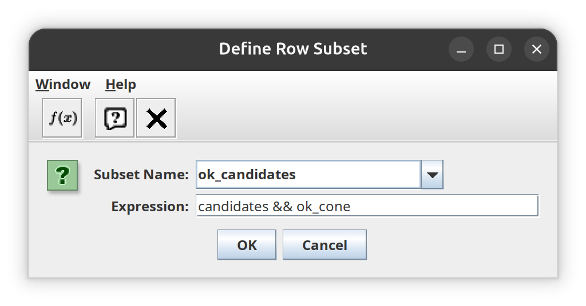

Look at the updated HRD:

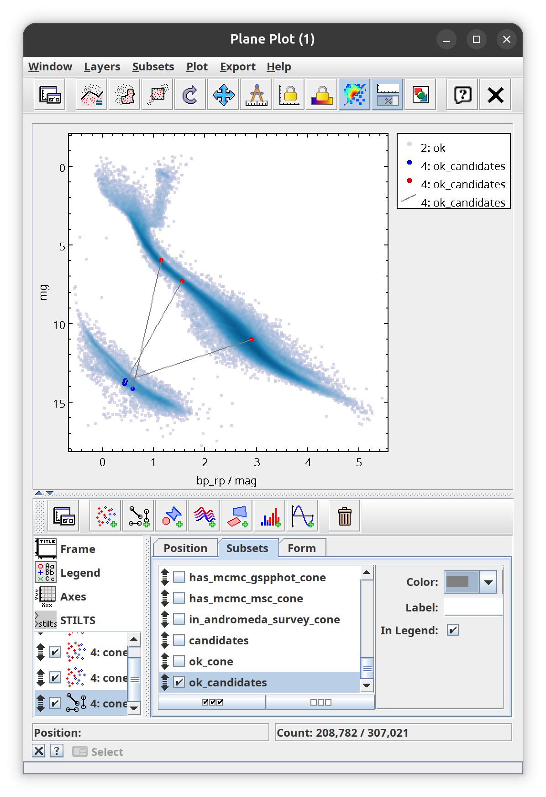

We are left with three main-sequence companion candidates (in the Python version of this search, 117 Gaia sources fall within 100 AU of 33 of the white dwarfs, and three survive the quality cuts). They are not necessarily real companions, and could be chance alignments, so we should check that their parallaxes and proper motions are consistent.

Calculate the projected separation in AU by adding a column `s`:

```
1000*Separation*60*60/parallax
```

(`Separation` is in degrees, so `Separation*3600` is in arcsec, and `1000/parallax` is the distance in pc; arcsec × pc = AU.)

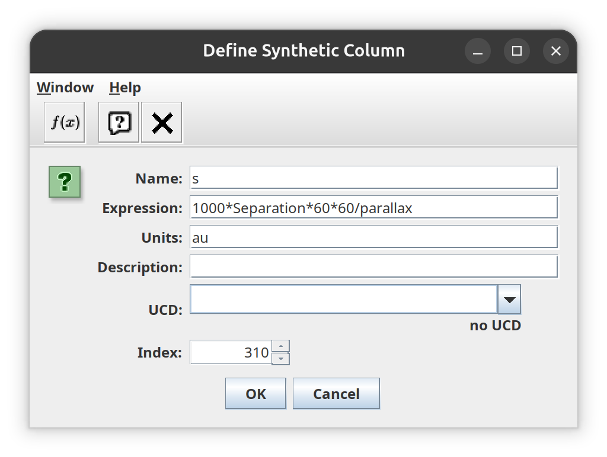

Verify that the parallaxes are consistent following [El-Badry and Rix 2018](https://ui.adsabs.harvard.edu/abs/2018MNRAS.480.4884E):

$$\left|\frac{1}{\varpi_1}-\frac{1}{\varpi_2}\right| - 2s \le 3\,\sigma_{\Delta d}, \qquad \sigma_{\Delta d} = \sqrt{\frac{\sigma_{\varpi_1}^2}{\varpi_1^4}+\frac{\sigma_{\varpi_2}^2}{\varpi_2^4}} ,$$

with distances and $s$ in pc (1 AU = 4.848 × 10⁻⁶ pc) and parallaxes in arcsec. Add a `within_parallax` subset:

```
1000*abs(1/parallax - 1/parallax_cone) - 2*s*4.848e-6 <= 3*1000*sqrt(pow(parallax_error,2)/pow(parallax,4) + pow(parallax_error_cone,2)/pow(parallax_cone,4))
```

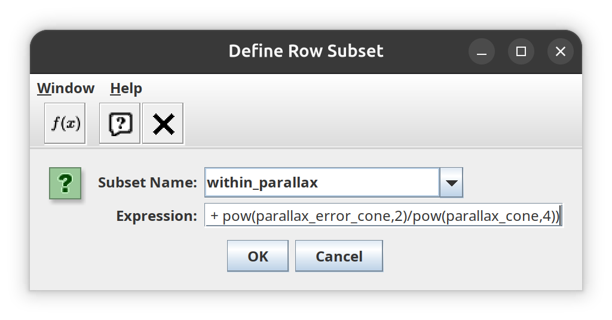

Edit `ok_candidates` to `candidates && ok_cone && within_parallax`. Only one system is left!

Verify that the tangential velocities are consistent. Calculate the tangential-velocity difference in km/s:

```
4.7405*sqrt(pow(pmra-pmra_cone,2) + pow(pmdec-pmdec_cone,2))/parallax
```

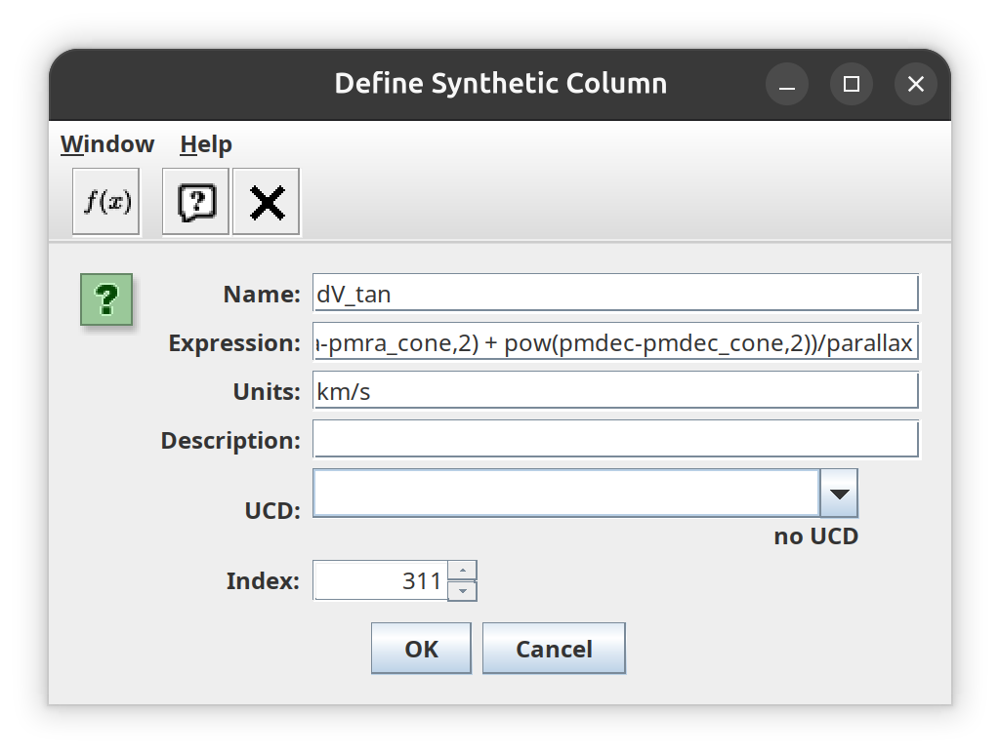

Plot `dV_tan` vs `s` (see e.g. fig. 7 of [Hollands et al. 2018](https://ui.adsabs.harvard.edu/abs/2018MNRAS.480.3942H)) and compare with the maximal tangential velocity of a binary in a circular orbit with a total mass of 1 M☉:

$$v_{\mathrm{orb}} = \sqrt{\frac{G M}{s}} = 29.78\,\mathrm{km\,s^{-1}}\sqrt{\frac{1\,\mathrm{AU}}{s}} ,$$

by adding **Layers > Add Function Control** with the function `29.78/sqrt(x)`:

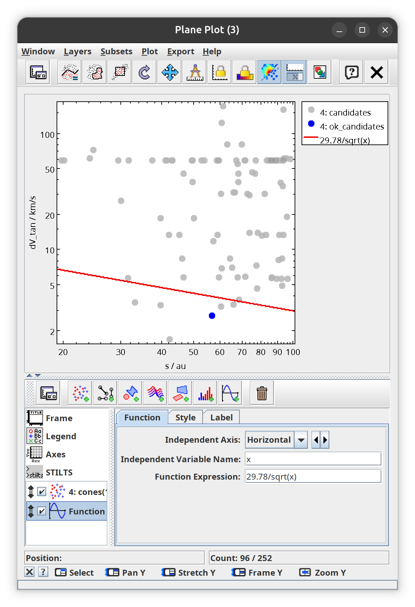

Both axes are logarithmic here (how? **Axes > Coords > X Log / Y Log**). The full, noisy candidate list is plotted for reference.

We are indeed left with one good candidate! Click on it to find its name; in the `cones(1)` table window its row is highlighted:

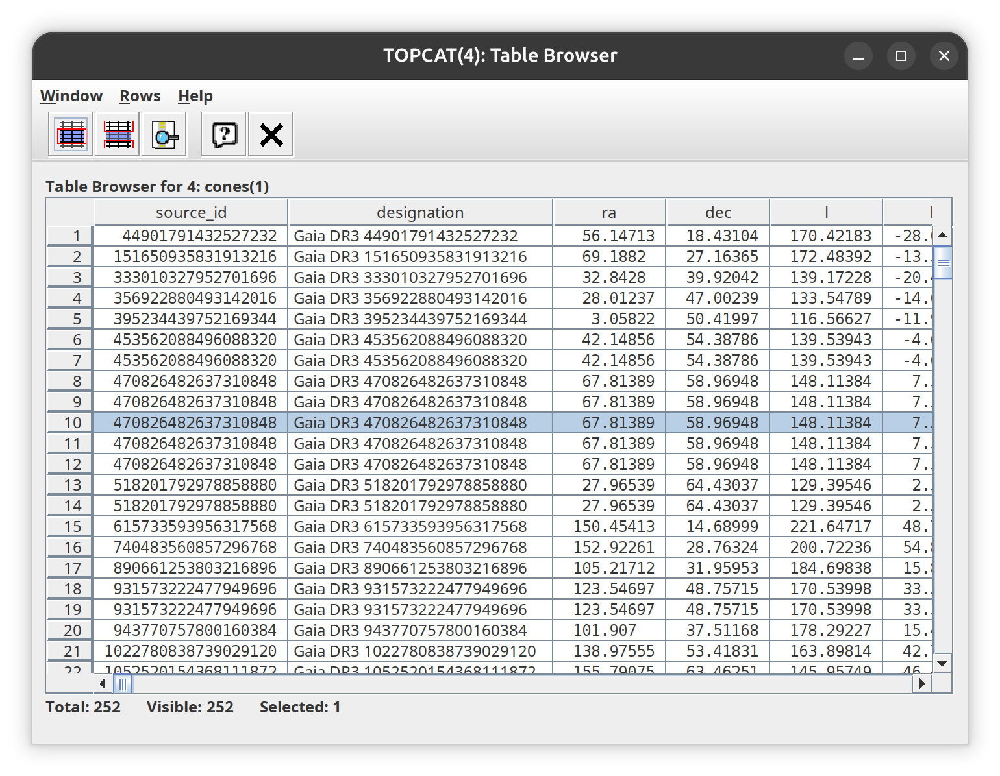

This is **Gaia DR3 470826482637310848 = WD 0426+588**, a known WD+dM binary at 5.5 pc: the white dwarf (G = 12.3) and its M-dwarf companion Gaia DR3 470826482637310080 (G = 9.7), 10.3″ ≈ 57 AU apart. We will meet both again in section 8, because the companion has an RVS spectrum and both have XP spectra.

## 6. Cross-matching a local table with Gaia

Let's assume we want to cross-match a local table of sources with an online TAP service (e.g. Gaia). For this example we use the Gaia DR2 WD 20 pc sample compiled by [Hollands et al. 2018](https://ui.adsabs.harvard.edu/abs/2018MNRAS.480.3942H): [table_20pc_WDs.csv](https://www.dropbox.com/s/dtqjo0911g4bfug/table_20pc_WDs.csv?dl=0). We want to retrieve the full Gaia DR3 data for each of these 139 sources.

First, get the Gaia DR3 ID of each source using the online `gaiadr3.dr2_neighbourhood` table (DR2 and DR3 source IDs are *not* the same; EDR3 and DR3 are). Load the WD 20 pc table into TOPCAT. Every column of an uploaded table must have an ADQL-compliant name (letters, digits and underscores only, not starting with a digit), otherwise the archive rejects the upload with an error such as `5 is not ADQL compliant`. This table has two offenders: rename "Gaia DR2 ID" to `dr2_source_id` and `J2015.5` to `J2015_5` (Column Info window, edit the **Name** cell). Note the table ID assigned by TOPCAT in the main window (here it was the 5th table loaded):

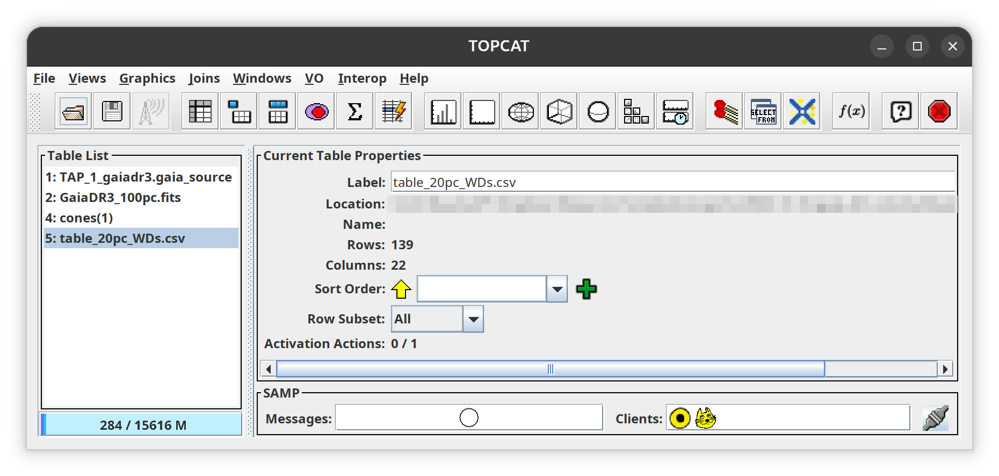

Now run a TAP query using the ESA Gaia TAP service, in **asynchronous** mode (the join against the 1.6-billion-row neighbourhood table can take a minute):

```sql
SELECT *
FROM gaiadr3.dr2_neighbourhood AS db
JOIN TAP_UPLOAD.t5 AS tc
ON db.dr2_source_id = tc.dr2_source_id
WHERE db.angular_distance < 5
```

`TAP_UPLOAD.t5` is the local table with ID 5. We limit the results to an angular distance smaller than 5 mas. All 139 DR2 sources have exactly one DR3 counterpart within 5 mas (without the `angular_distance` cut a few of them get a second, distant neighbour, which is what the cut is for).

Now we have a new table (TOPCAT ID 6) with the DR3 source IDs of the sample, and we can use it to retrieve the DR3 data:

```sql
SELECT *
FROM gaiadr3.gaia_source AS db
JOIN TAP_UPLOAD.t6 AS tc
ON db.source_id = tc.dr3_source_id
```

> [!TIP]
> **Cross-match tables in the archive**
> `gaiadr3.dr2_neighbourhood` is one of the archive's pre-computed cross-match tables: for every DR2 source it lists the DR3 sources nearby, with `angular_distance` (mas) and `magnitude_difference`, so you never need to match DR2 and DR3 by position yourself (the same source can have a different `source_id` in the two releases). DR4 is expected to come with the equivalent `dr3_neighbourhood` table. The two steps above can also be written as one query, joining the neighbourhood table and `gaia_source` directly:
>
> ```sql
> SELECT tc.WD, db.angular_distance, g.*
> FROM gaiadr3.gaia_source AS g
> JOIN gaiadr3.dr2_neighbourhood AS db ON g.source_id = db.dr3_source_id
> JOIN TAP_UPLOAD.t5 AS tc ON db.dr2_source_id = tc.dr2_source_id
> WHERE db.angular_distance < 5
> ```
>
> The archive holds similar `*_neighbourhood` / `*_best_neighbour` tables for external catalogues (2MASS, AllWISE, Pan-STARRS1, SDSS DR13, SkyMapper, APASS, Hipparcos-2, Tycho-2, RAVE, URAT1, GSC 2.3); the `best_neighbour` tables keep one match per Gaia source.

That's it! Add an `mg` column and plot it over the 100 pc HRD from earlier:

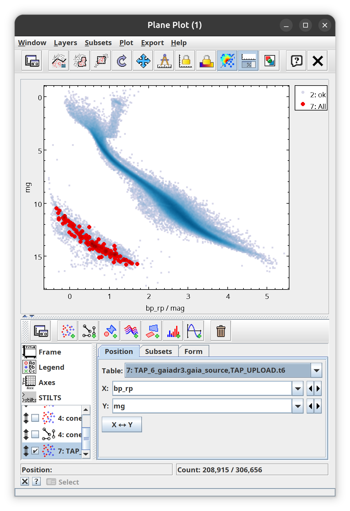

Among these 139 white dwarfs, 74 have XP sampled spectra (all 139 have the continuous ones) and 12 have epoch photometry in DR3 (check with `has_xp_sampled` and `has_epoch_photometry` in the Row Subsets window). Keep this table: section 8 uses it.

> [!TIP]
> **Other ways to match**
> TOPCAT's **VO > CDS Upload X-Match** matches millions of rows against any VizieR table (including `I/355/gaiadr3`) in seconds, by position. **Joins > Pair Match** matches two loaded tables. The archive's pre-computed cross-match tables are described in the tip above.

## 7. Linking TOPCAT and Aladin

If you have Aladin installed, you can link it with TOPCAT using **SAMP** (Simple Application Messaging Protocol), so that when you pick a source from a table Aladin automatically centres on its coordinates:

1. Launch Aladin.
2. In TOPCAT's main window: **Views > Activation Actions**.
3. Tick **Send Sky Coordinates**.

Now clicking a point in a plot or a row in a table re-centres Aladin. You can also send the current TOPCAT table to Aladin with **Interop > Send table to… > Aladin**, and send a table from Aladin's stack (right pane) to TOPCAT by right-clicking it and choosing **Broadcast selected tables to… > TOPCAT**. The same mechanism connects TOPCAT to Python (`astropy.samp`, or the `samp` option of pyvo) and to DS9.

## 8. Datalink: spectra and light curves in TOPCAT

The bulky DR3 products are **not** columns of the database tables and cannot be reached with ADQL. For each source, a few flags in `gaia_source` tell you what exists:

| flag | product | DR3 sources |
|---|---|---|
| `has_xp_continuous` | mean BP/RP spectrum as basis-function coefficients (the native product; input of GaiaXPy) | 219 million |
| `has_xp_sampled` | the same spectrum sampled in wavelength, 336–1020 nm in 2 nm steps (a subset of the above) | 35 million |
| `has_rvs` | mean RVS spectrum, 846–870 nm | 1 million |
| `has_epoch_photometry` | G, BP, RP light curves (only for the ~12 million sources in the variability tables in DR3; **all** sources in DR4) | 12 million |
| `has_mcmc_gspphot`, `has_mcmc_msc` | MCMC samples of the astrophysical-parameter fits | |

These products are served through the [**Datalink**](https://www.cosmos.esa.int/web/gaia-users/archive/datalink-products) protocol: every row of a query result carries a link to a small *links table* listing the files available for that source. TOPCAT uses it through **Activation Actions**: something that happens when you click on a row or a plotted point.

### Fetching the spectra of WD 0426+588 and its companion

1. In the TAP window, run (synchronously) a query that returns the `designation` or `source_id` column (either is fine; TOPCAT recognises the Datalink **service descriptor** that the ESA archive attaches to every query result):

   ```sql
   SELECT source_id, designation, ra, dec, parallax, phot_g_mean_mag, bp_rp,
          has_xp_continuous, has_xp_sampled, has_rvs, has_epoch_photometry
   FROM gaiadr3.gaia_source
   WHERE source_id IN (470826482637310848, 470826482637310080, 2660358032257156736)
   ```

   The third source is **G 29-38** (ZZ Psc), the pulsating DA white dwarf with a debris disc at 17.5 pc: it has both XP spectra and epoch photometry.

2. With the new table selected in the main window, open **Views > Activation Actions**. The list on the left shows the actions available for this table; it includes **Invoke Service**, which only appears for tables that carry a Datalink *service descriptor*, i.e. results of the ESA TAP service with `designation`/`source_id` selected. Select it and set its **Action** to **View DataLink Table**; the panel shows the descriptor's name (`ancillary`) and base URL (`…/data-server/datalink/links`).

   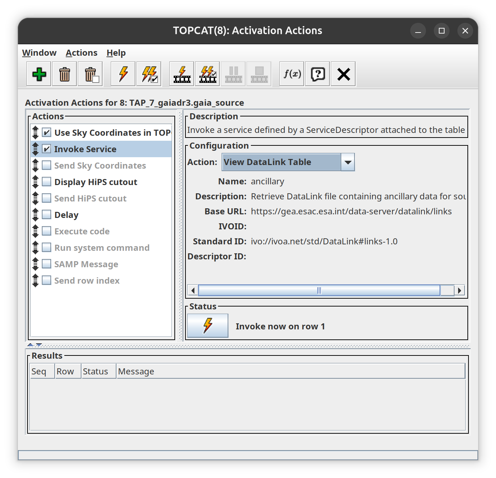

3. Tick the checkbox next to **Invoke Service** and click a row in the table's **Table Browser** (Views > Table Data), or a point in a plot. A **DataLink** window pops up listing the products available for that source (`XP_SAMPLED`, `XP_CONTINUOUS`, `RVS`, `EPOCH_PHOTOMETRY`, …), one row per product, with its `access_url`:

   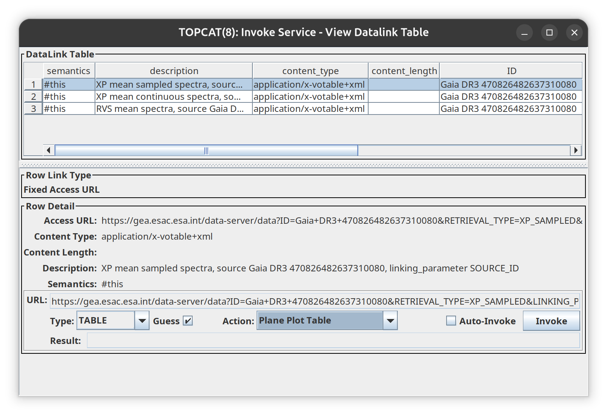

4. Select the `XP_SAMPLED` row. In the lower panel, set **Type** to *Table* and **Action** to **Plane Plot Table** (or **Load Table** to get it as a new table in TOPCAT), and press **Invoke**. A plot of `flux` vs `wavelength` appears: the Gaia low-resolution spectrum of the source. Do the same for the `RVS` row of the M dwarf (Gaia DR3 470826482637310080): the Ca II infrared triplet (849.8, 854.2, 866.2 nm) is obvious.

   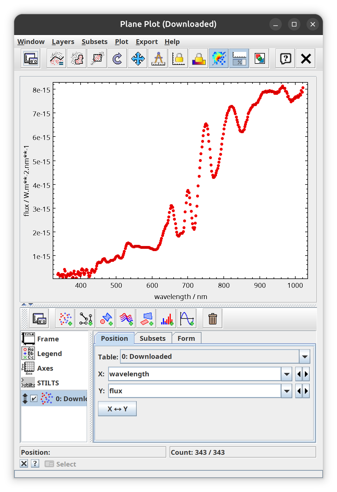
   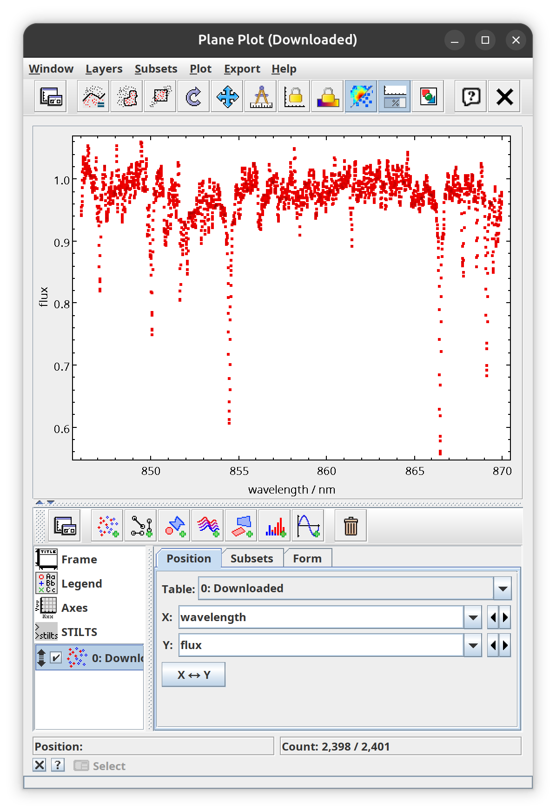

5. For **G 29-38** select `EPOCH_PHOTOMETRY` → **Load Table**. The loaded table has one row per transit with `g_transit_time`, `g_transit_mag`, `bp_obs_time`, `bp_mag`, `rp_obs_time`, `rp_mag` and quality flags (`rejected_by_photometry`, `*_other_flags`). Plane-plot `g_transit_mag` vs `g_transit_time` (flip Y): a 30-point light curve with the scatter of a ZZ Ceti pulsator. (Since December 2024 the epoch-photometry files follow the IVOA time-series model, see [this Image of the Week](https://www.cosmos.esa.int/web/gaia/iow_20241203).)

   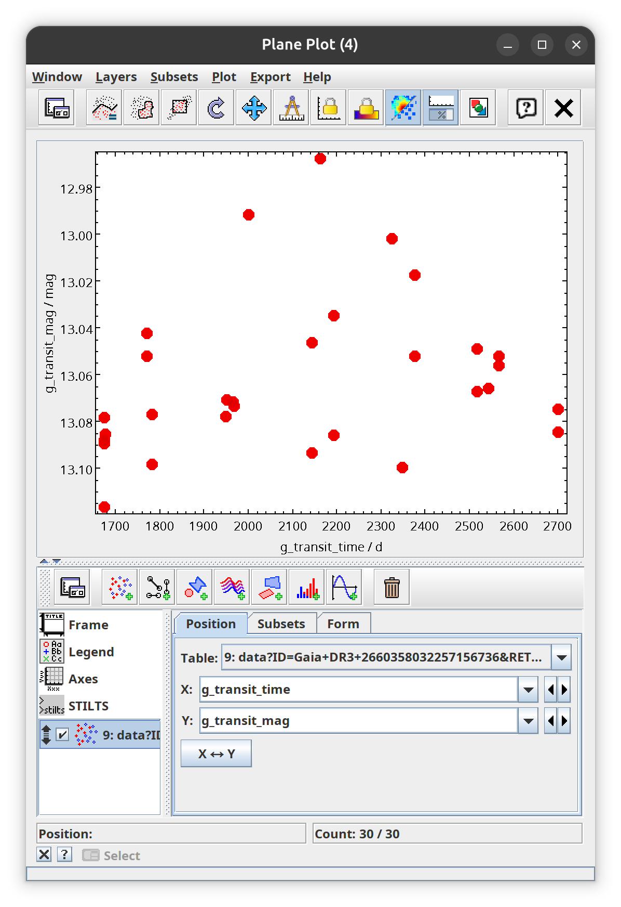

### Doing it for many sources at once

Activation actions work on one source per click. For a whole table, use the Gaia archive web interface: run the query there, then click the Datalink icon in the job list and choose the products, data structure and format. Registered users can request up to 5000 sources per Datalink call; **anonymous requests are limited to 50 sources** since October 2026, which also applies to GaiaXPy calls made without logging in. Python (section 10) is the other route. The underlying URLs are plain HTTP and can be used from anywhere:

```
https://gea.esac.esa.int/data-server/datalink/links?ID=Gaia+DR3+2660358032257156736
https://gea.esac.esa.int/data-server/data?RETRIEVAL_TYPE=XP_SAMPLED&RELEASE=Gaia+DR3&ID=Gaia+DR3+2660358032257156736&DATA_STRUCTURE=DATAMODEL_STANDARD&FORMAT=csv
```

`RETRIEVAL_TYPE` is one of `XP_SAMPLED`, `XP_CONTINUOUS`, `RVS`, `EPOCH_PHOTOMETRY`, `MCMC_GSPPHOT`, `MCMC_MSC`, `ALL`; `ID` accepts a comma-separated list; `FORMAT` is `VOTABLE` (default), `FITS`, `CSV` or `ECSV`. `DATA_STRUCTURE=DATAMODEL_STANDARD` gives one file per source and product with IVOA-style columns (`wavelength`, `flux`, `flux_error`), `DATAMODEL_GAIA` gives one file per product with all sources in the Gaia data-model layout (array-valued columns). These two names replaced `INDIVIDUAL` and `RAW` in the October 2026 archive release; the old names now return an error.

> [!TIP]
> **Many spectra in one table: array columns in TOPCAT**
> With `DATA_STRUCTURE=DATAMODEL_GAIA` the data server returns *one* table with one row per source and the spectrum as an array column, which TOPCAT can plot all at once. To get the XP sampled spectra of our three sources this way:
>
> 1. In TOPCAT's main window choose **File > Load Table** and paste this URL into the **Location** field (TOPCAT downloads it directly; or download it in a browser and load the file):
>    ```
>    https://gea.esac.esa.int/data-server/data?RETRIEVAL_TYPE=XP_SAMPLED&RELEASE=Gaia+DR3&ID=470826482637310848,470826482637310080,2660358032257156736&DATA_STRUCTURE=DATAMODEL_GAIA&FORMAT=fits
>    ```
>    `ID` takes a comma-separated list of source ids (up to 50 anonymously, 5000 logged in), or `job:<job id>.source_id` to use the result of an archive query. The loaded table has 3 rows and the columns `source_id`, `ra`, `dec`, `flux` and `flux_error`, the last two being 343-element arrays.
> 2. Open a **Plane Plot** of this table and add **Layers > Add XYArray Control**. Set **Y Values** to `flux` and **X Values** to `sequence(343, 336, 2)`: the file does not carry the wavelength grid, which for XP sampled spectra is always 336–1020 nm in 2 nm steps. Each row becomes one line; set **Y Log** in the Axes control to see the white dwarfs next to the M dwarf.
> 3. Enable the **Handles** form in the Forms tab to make the lines clickable (an activation action, e.g. **View Datalink Table**, then works from the plot too).
>
> 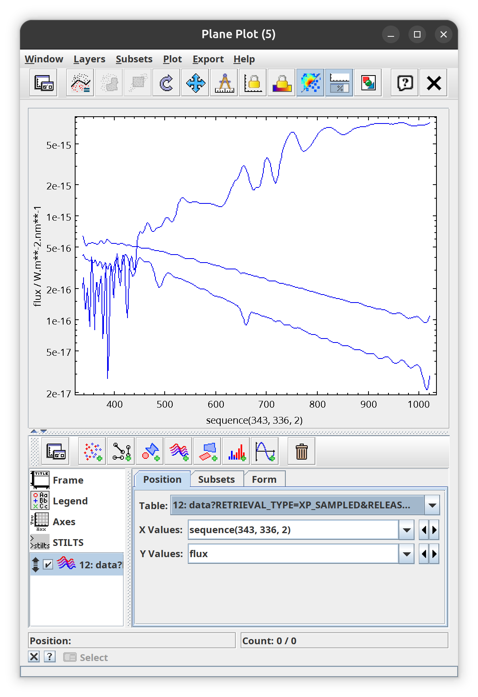

## 9. Gaia with Python

TOPCAT is a great tool for exploring the data. Once you know what you are looking for, continue in Python. The companion notebook [`gaia_dr4_workshop.ipynb`](https://github.com/naamach/gaia-dr4-workshop) repeats everything above with [`astroquery.gaia`](https://astroquery.readthedocs.io/en/latest/gaia/gaia.html) and adds the GaiaXPy part. It expects the repository's `data/` folder: `GaiaDR3_100pc.fits` (download it from the release into `data/`), `table_20pc_WDs.csv`, and the cached Datalink downloads (`datalink/`, `datalink_rrlyr/`, `xp_continuous_20pc_wds.fits`, `xp_continuous_cvs.fits`). With those in place the notebook runs even when the archive is busy or in maintenance (it returns HTTP 503 then); only the TAP queries themselves need the archive. The essentials:

```python
from astroquery.gaia import Gaia
Gaia.ROW_LIMIT = -1                      # astroquery's own default is 2000 rows
# Gaia.login()                           # registered-user quotas; prompts for the Cosmos credentials

job = Gaia.launch_job("SELECT TOP 100 * FROM gaiadr3.gaia_source WHERE parallax > 100")      # synchronous
job = Gaia.launch_job_async("SELECT * FROM gaiadr3.gaia_source_lite WHERE parallax > 10")      # asynchronous
table = job.get_results()                # an astropy Table

# upload a local astropy Table and use it in the query as tap_upload.t1
job = Gaia.launch_job_async(query, upload_resource=my_table, upload_table_name="t1")

# cone search
from astropy.coordinates import SkyCoord; import astropy.units as u
job = Gaia.cone_search(SkyCoord("04 31 15.33 +58 58 10.13", unit=(u.hourangle, u.deg)), radius=15 * u.arcsec)   # _async for big radii

# Datalink products: a dict of {file name: [table]} keyed like "XP_SAMPLED_Gaia_DR3_<source_id>.xml"
products = Gaia.load_data(ids=[470826482637310848, 470826482637310080], data_release="Gaia DR3",
                          retrieval_type="ALL", data_structure="DATAMODEL_STANDARD", format="votable")
```

Notes from running this on 2026-10-18: the ESA archive currently rejects asynchronous jobs that ask for `output_format="csv"` or `"fits"` (use the default VOTable); `data_structure="INDIVIDUAL"` is rejected (use `DATAMODEL_STANDARD`). The notebook also shows how to run the same ADQL on the ARI-Gaia mirror with `pyvo`, which has no anonymous time limit.

## 10. GaiaXPy

The XP **continuous** spectra are the native DR3 product: coefficients of an expansion in basis functions, from which spectra can be reconstructed on any wavelength grid, with full covariances. [**GaiaXPy**](https://gaia-dpci.github.io/GaiaXPy-website/) ([documentation](https://gaiaxpy.readthedocs.io), [GitHub](https://github.com/gaia-dpci/GaiaXPy)) is the DPAC package for them. Install with `pip install gaiaxpy` (≥ 2.1.5, released 2026-10-15, is needed for the current archive). It has four tools:

| tool | output |
|---|---|
| `calibrate(input, sampling=None)` | externally calibrated spectrum: absolute flux (W m⁻² nm⁻¹) vs wavelength, default 336–1020 nm in 2 nm steps, any sampling you like (e.g. `np.geomspace(330, 1050, 600)`) |
| `convert(input, sampling=None)` | internally calibrated BP and RP spectra in pseudo-wavelength (the instrument's own system), for work close to the data |
| `generate(input, photometric_system=...)` | synthetic photometry in SDSS, Johnson-Kron-Cousins, Pan-STARRS1, LSST, Euclid, HST, Strömgren, Gaia itself, … (`PhotometricSystem.get_available_systems()`), with optional `error_correction` and `truncation` |
| `plot_spectra(df, sampling, multi=True)` | quick-look plots |

`input` can be a **list of source IDs** (GaiaXPy queries the archive for you), an **ADQL query string** (e.g. `"SELECT source_id FROM gaiadr3.gaia_source WHERE parallax > 50 AND has_xp_continuous = 'True'"`), a **file** of XP continuous spectra downloaded from the archive (`DATAMODEL_GAIA` structure, csv/ecsv/fits/xml), or a **DataFrame**. Use `save_file=False` to keep the result in memory instead of writing it to disk.

```python
import numpy as np
from gaiaxpy import calibrate, convert, generate, plot_spectra, PhotometricSystem

ids = [470826482637310848, 470826482637310080, 2660358032257156736]   # WD 0426+588, its M dwarf, G 29-38
calibrated, sampling = calibrate(ids, save_file=False)
plot_spectra(calibrated, sampling=sampling, multi=True)

fine, fine_sampling = calibrate(ids, sampling=np.geomspace(330, 1049.99, 600), save_file=False)
converted, pw = convert(ids, save_file=False)
synth = generate(ids, photometric_system=[PhotometricSystem.SDSS, PhotometricSystem.JKC, PhotometricSystem.Gaia_DR3_Vega],
                 save_file=False)
```

Each row of `calibrated` holds one source with `flux` and `flux_error` arrays on `sampling`. For our three sources the synthetic Gaia G from `generate` agrees with the catalogue `phot_g_mean_mag` to within a few mmag (a useful sanity check of the pipeline). Things to keep in mind: the XP spectra are mean spectra over 34 months; the effective resolution is low ($R \sim 30$–100) and wavelength dependent; fluxes below ~400 nm and above ~900 nm are the least reliable; and the calibrated spectra are *not* independent of the catalogue photometry. See [De Angeli et al. (2023)](https://ui.adsabs.harvard.edu/abs/2023A%26A...674A...2D) (processing) and [Montegriffo et al. (2023)](https://ui.adsabs.harvard.edu/abs/2023A%26A...674A...3M) (external calibration) for the details, and [Galiullin et al. 2026](https://ui.adsabs.harvard.edu/abs/2026arXiv260728736G) for what emission lines look like in XP spectra (exercise H).

## 11. Known caveats

- Catalogue validation: [Babusiaux et al. (2023), Gaia DR3: Catalogue validation](https://ui.adsabs.harvard.edu/abs/2023A%26A...674A..32B), and the [DR3 known issues](https://www.cosmos.esa.int/web/gaia/dr3-known-issues) page. The release summary is [Gaia Collaboration, Vallenari et al. (2023)](https://ui.adsabs.harvard.edu/abs/2023A%26A...674A...1G).
- **Estimating distances from parallaxes.** If `parallax_over_error` ≳ 5 it is reasonable to use 1/parallax; otherwise use the geometric and photogeometric distances of [Bailer-Jones et al. 2021](https://ui.adsabs.harvard.edu/abs/2021AJ....161..147B) (table `external.gaiaedr3_distance` in the archive; EDR3 and DR3 astrometry are identical).
- **Parallax zero point.** [Lindegren et al. 2021](https://ui.adsabs.harvard.edu/abs/2021A&A...649A...4L); code at https://www.cosmos.esa.int/web/gaia/edr3-code (`gaiadr3_zeropoint` on PyPI). The parallaxes of (E)DR3 have a median bias of about −17 μas that depends on magnitude, colour and position; it matters for faint and distant sources, not for the 100 pc sample.
- **Photometric corrections.** [Riello et al. 2021](https://ui.adsabs.harvard.edu/abs/2021A&A...649A...3R): the corrected excess factor $C^*$ and the G-band correction for 6-parameter solutions; DR3 photometry is that of EDR3.
- **RUWE and binaries.** RUWE > 1.4 removes bad solutions but also removes many unresolved binaries, and a RUWE slightly above 1 can already indicate one ([Gaia Collaboration, Arenou et al. 2023](https://ui.adsabs.harvard.edu/abs/2023A&A...674A..34G)). Decide which you are doing: cleaning a sample, or looking for binaries.
- **XP spectra:** see the notes at the end of section 10; the `has_xp_sampled` subset is not representative (brighter, better-behaved sources).
- **Epoch photometry in DR3** exists only for sources in the variability tables; **DR4** will publish it for every source, so the `has_epoch_photometry` flag will become much less restrictive.

## Exercises

### A. Exploring the Messier 4 cluster

1. Retrieve the Gaia data of the M4 region (hint: **VO > Cone Search** with a 0.3° radius, service "Gaia DR3 at ESA" or ARI).
2. Identify the comoving cluster (hint: plot the proper motions).
   1. Create a `comoving` subset (hint: **Draw Blob Subset**).
   2. Create a `not_comoving` subset (hint: **Invert Subset**).
3. Plot the sky positions of the stars with their proper-motion vectors (hint: **Graphics > Sky Plot**, **Form > Forms > Add SkyVector**).
4. Measure the distance to the cluster (hint: **Graphics > Histogram Plot** of the parallax, **Form > Forms > Gaussian**; alternatively **Views > Column Statistics**). Compare with the literature value, ~1.85 kpc.

### B. Epoch photometry of an RR Lyrae star

1. From `gaiadr3.vari_rrlyrae`, get the fundamental period `pf` of RR Lyr itself (Gaia DR3 2125982599343482624), and look at the other columns of that table (mean magnitudes, amplitudes, Fourier parameters, metallicity).
2. Fetch its epoch photometry through Datalink (section 8), plot the G light curve, then fold it on `pf` (hint: add a column `(g_transit_time/pf) % 1`; `pf` can be typed in as a number).
3. Retrieve a table while **excluding** sources listed in a locally stored table, with a `NOT IN (SELECT … FROM TAP_UPLOAD.t1)` sub-query. For example, retrieve `gaiadr3.vari_rrlyrae` sources brighter than G = 10 excluding a local list of IDs.

### C. Find wide binaries in the WD 20 pc sample using Python

Search for wide binaries around the WD 20 pc sample of Hollands et al. (2018) (section 6) within 100 AU. Make sure they have reliable astrometry and photometry, and that they have consistent distances and velocities (section 5), this time in Python.

### D. Explore the Gaia-ESO DR5 catalogue

http://archive.eso.org/cms/eso-archive-news/Fifth-Gaia-ESO-data-release-astrophysical-parameters-of-about-115000-stars.html — the catalogue: https://dataportal.eso.org/dataPortal/file/ADP.2022-05-13T08:55:20.081. Cross-match it with Gaia DR3 (by `source_id` or by position with the CDS X-Match) and compare the Gaia-ESO and Gaia (GSP-Phot, `teff_gspphot`) temperatures.

### E. Explore the NASA Exoplanet archive

For this exercise the [NASA Exoplanet Archive](https://exoplanetarchive.ipac.caltech.edu/) planetary-systems composite table is the local table: [ExoplanetArchive_pscomppars.fits](https://www.dropbox.com/s/huy1wxky10digly/ExoplanetArchive_pscomppars.fits?dl=0) (it has a `gaia_id` column). Where do the planet hosts sit on the HRD? Which hosts have `non_single_star > 0` or RUWE > 1.4?

### F. Gaia + Kepler = Fun

https://gaia-kepler.fun/ — explore cross-matched catalogues of Gaia sources observed with Kepler/K2.

### G. Synthetic SDSS colours of the 20 pc white dwarfs (GaiaXPy)

Take the DR3 table of the Hollands et al. (2018) white dwarfs from section 6 (or query `gaiadr3.gaia_source` for WDs within 20 pc with `has_xp_continuous = 'True'`). Use GaiaXPy's `generate` to compute synthetic SDSS *ugriz* magnitudes, and plot $u-g$ vs $g-r$ coloured by the spectral type from the Hollands table. Why do DA white dwarfs separate from the DC ones in this diagram? (Hint: where is the Balmer jump?)

### H. Emission lines in XP spectra (GaiaXPy)

Even at the resolution of XP, strong Hα emission is detectable; [Galiullin et al. 2026](https://ui.adsabs.harvard.edu/abs/2026arXiv260728736G) built a whole CV census on it. Calibrate the XP spectra of a few well-known CVs (SS Cyg, AM Her, U Gem, WZ Sge, EX Hya, …; resolve the Gaia DR3 IDs with SIMBAD) and of the 20 pc white dwarfs, define an Hα index as the mean flux in 650–662 nm divided by the mean flux in the neighbouring continuum (630–645 and 668–685 nm), and compare the two populations. Which CVs show no emission, and why?

## Solutions

### A. Exploring the Messier 4 cluster

See Mark Taylor's TOPCAT tutorial, which does this for NGC 7092 and other clusters with DR3: https://github.com/mbtaylor/tctuto/releases (latest PDF), and his [TOPCAT and Gaia DR3 slides](https://www.star.bris.ac.uk/mbt/talks/nam2023/tcgaia.pdf).

### B. Epoch photometry of an RR Lyrae star

```sql
SELECT source_id, pf, best_classification, num_clean_epochs_g, int_average_g, peak_to_peak_g
FROM gaiadr3.vari_rrlyrae
WHERE source_id = 2125982599343482624
```

gives `pf` = 0.56677 d (RRab, 37 clean G epochs, G̅ = 7.64, peak-to-peak 0.80 mag). Then **Views > Activation Actions > View Datalink Table**, click the row, choose `EPOCH_PHOTOMETRY` → **Load Table**, add a column `phase = (g_transit_time/0.5667732) % 1` and plot `g_transit_mag` vs `phase` (flip Y). The Python version is in the notebook.

The exclusion sub-query (assuming the local list is table 1 in TOPCAT and its ID column is called `source_id`):

```sql
SELECT *
FROM gaiadr3.vari_rrlyrae AS db
WHERE db.int_average_g < 10
AND db.source_id NOT IN
  (SELECT tc.source_id FROM TAP_UPLOAD.t1 AS tc)
```

### C. Find wide binaries in the WD 20 pc sample using Python

In the notebook (`### C.`). In ADQL the multicone becomes a single upload join:

```sql
SELECT tc.*, g.source_id, g.parallax, g.parallax_error, g.pmra, g.pmdec, g.phot_g_mean_mag, g.bp_rp, g.ruwe, ...,
       DISTANCE(POINT('ICRS', tc.wd_ra, tc.wd_dec), POINT('ICRS', g.ra, g.dec)) * 3600 AS sep_arcsec
FROM tap_upload.t1 AS tc
JOIN gaiadr3.gaia_source AS g
  ON 1 = CONTAINS(POINT('ICRS', g.ra, g.dec), CIRCLE('ICRS', tc.wd_ra, tc.wd_dec, tc.cone_radius_deg))
WHERE g.source_id <> tc.wd_source_id
```

followed by the same quality, parallax-consistency and velocity cuts as in section 5. Result on 2026-10-18: 117 neighbours within 100 AU of 33 white dwarfs, 3 with good astrometry and photometry, 1 with a consistent parallax, and the same one with a consistent tangential velocity: WD 0426+588 and its M dwarf, Gaia DR3 470826482637310080, at 57 AU. The Δv_tan vs. separation plot with the circular-orbit line is the last cell of that section.

### G. Synthetic SDSS colours of the 20 pc white dwarfs

In the notebook (`### G.`). All 139 Hollands et al. (2018) white dwarfs have XP continuous spectra; `generate` on the cached Datalink table gives SDSS *ugriz* for 70 DA, 29 DC and 40 other (DB, DQ, DZ, DAP, …) white dwarfs. In $u-g$ vs $g-r$ the two populations follow the same overall sequence (both are essentially thermal continua at this resolution), but the hot DAs ($g-r \lesssim 0$, $T_{\mathrm{eff}} \gtrsim 9000$ K) form a plateau at $u-g \approx 0.4$–0.5 that lies *above* the extrapolated DC/blackbody locus: the Balmer jump (364.6 nm) sits inside the *u* band and suppresses the *u* flux, so a DA is redder in $u-g$ than a featureless star of the same $g-r$. Cool DAs ($T_{\mathrm{eff}} \lesssim 7000$ K) lose their Balmer lines and become indistinguishable from DCs here, and the DQ/DZ stars scatter off the sequence because of their carbon and metal features. Merge the spectral types on `source_id`, not on the WD name: the Hollands table lists both components of double degenerates under the same WD name.

### H. Emission lines in XP spectra

In the notebook (`### H.`). The XP continuous spectra are fetched once through Datalink (50 sources per request) and cached as FITS, then calibrated from the DataFrame, so no further archive access is needed. Result: the 139 white dwarfs have Hα indices between 0.75 and 1.05 (median 0.97; the values below 1 are the Hα *absorption* of the DAs, G 29-38 at 0.75 being the deepest), while the CVs range from 0.99 to 2.0: WZ Sge 2.00, U Gem 1.74, EX Hya 1.72, AM Her 1.68, SS Cyg 1.33, RX And 1.27, GK Per 1.14, TT Ari 1.03, IX Vel 0.99. The two without emission, IX Vel and TT Ari, are nova-like variables: their discs accrete at a high rate and are optically thick, so the optical spectrum is dominated by the disc continuum and the Balmer lines are weak or in absorption, whereas the dwarf novae in quiescence (WZ Sge, U Gem, SS Cyg) and the magnetic systems (AM Her, EX Hya) show strong emission.

## References and links

- TOPCAT: https://www.star.bris.ac.uk/~mbt/topcat/ — manual (SUN/253): https://www.star.bris.ac.uk/~mbt/topcat/sun253/ — STILTS (the command-line twin): https://www.star.bris.ac.uk/~mbt/stilts/
- Gaia archive: https://gea.esac.esa.int/archive/ — help: https://www.cosmos.esa.int/web/gaia-users/archive — Datalink products: https://www.cosmos.esa.int/web/gaia-users/archive/datalink-products — DR3 papers: https://www.cosmos.esa.int/web/gaia/dr3-papers — DR4 contents: https://www.cosmos.esa.int/web/gaia/dr4
- astroquery.gaia: https://astroquery.readthedocs.io/en/latest/gaia/gaia.html — pyvo: https://pyvo.readthedocs.io
- GaiaXPy: https://gaia-dpci.github.io/GaiaXPy-website/ — docs: https://gaiaxpy.readthedocs.io
- ADQL: https://www.ivoa.net/documents/ADQL/ — SIMBAD cheat sheet: https://simbad.cds.unistra.fr/simbad/tap/help/adqlHelp.html


---

*Written by Na'ama Hallakoun for the Gaia DR3 hands-on workshop (2022) of the Department of Particle Physics and Astrophysics, Weizmann Institute of Science, and updated by her for the department's Gaia DR4 hands-on workshop (October 2026); the update was prepared with the help of Claude Fable 5.1 (Anthropic). All screenshots were taken with TOPCAT 4.10 on Gaia DR3 data.*